<p align="center">
  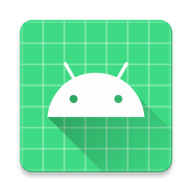
</p>

# 📦 EasyStock: Your Offline NFC Stock Manager

<p align="center">
  <a href="https://github.com/Mathorck/EasyStock/releases/latest"></a>
</p>

<p align="center">
  <a href="https://github.com/Mathorck/EasyStock/releases/latest"></a>
  <a href="https://github.com/Mathorck/EasyStock/actions/workflows/release.yml"></a>
  <a href="LICENSE"></a>
  
  
  
  
</p>

---

## Screenshots

<table align="center">
  <tr>
    <td align="center" valign="top">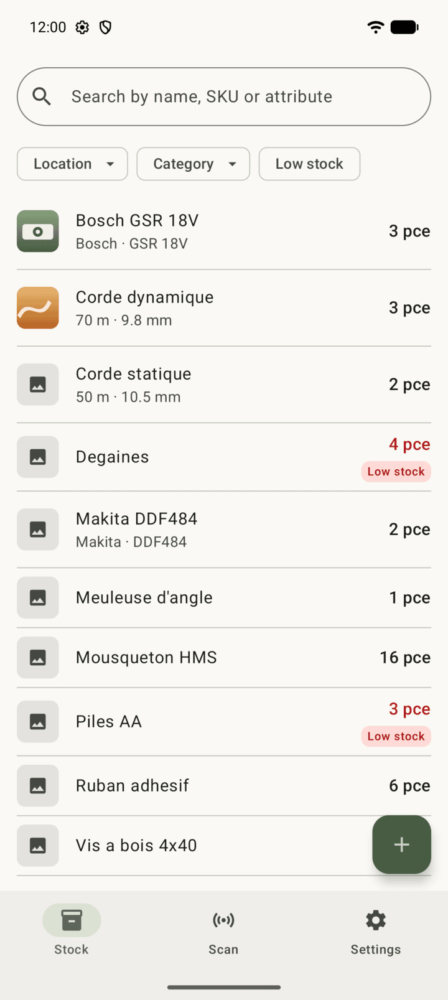<br><sub><i>Stock list with low-stock flags and attribute summaries</i></sub></td>
    <td align="center" valign="top">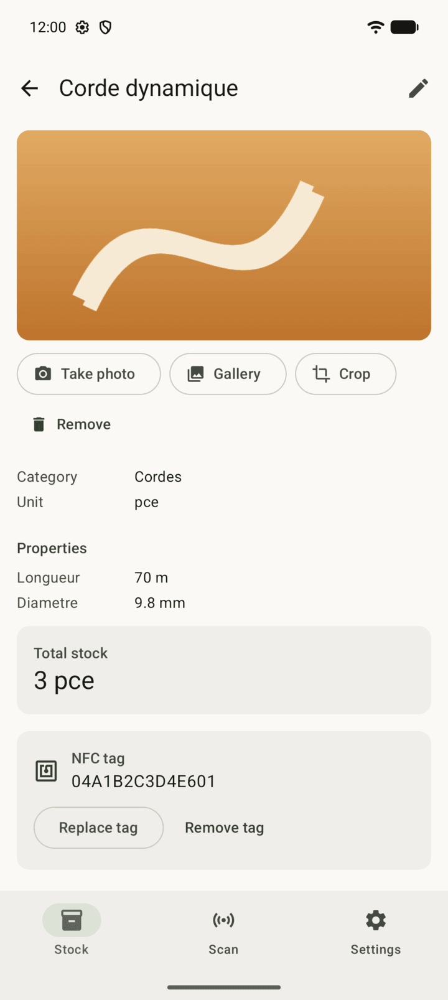<br><sub><i>Article detail: photo, properties, stock and NFC tag</i></sub></td>
    <td align="center" valign="top">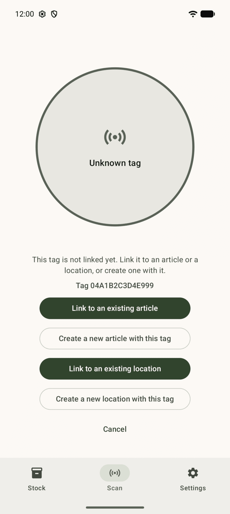<br><sub><i>Scanning an unknown tag: link or create an article or a location</i></sub></td>
  </tr>
  <tr>
    <td align="center" valign="top">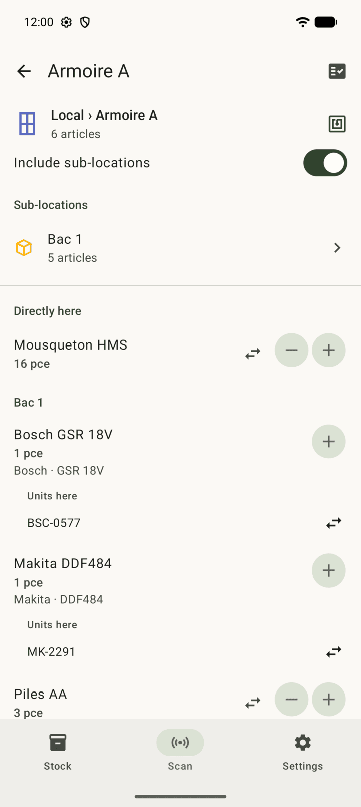<br><sub><i>Scanning a location tag: its contents, sub-locations included</i></sub></td>
    <td align="center" valign="top">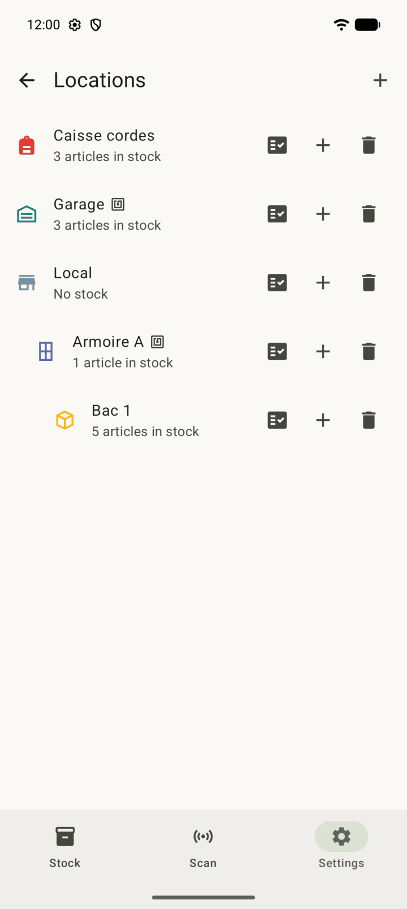<br><sub><i>Locations with hierarchy, icons and colors</i></sub></td>
    <td align="center" valign="top">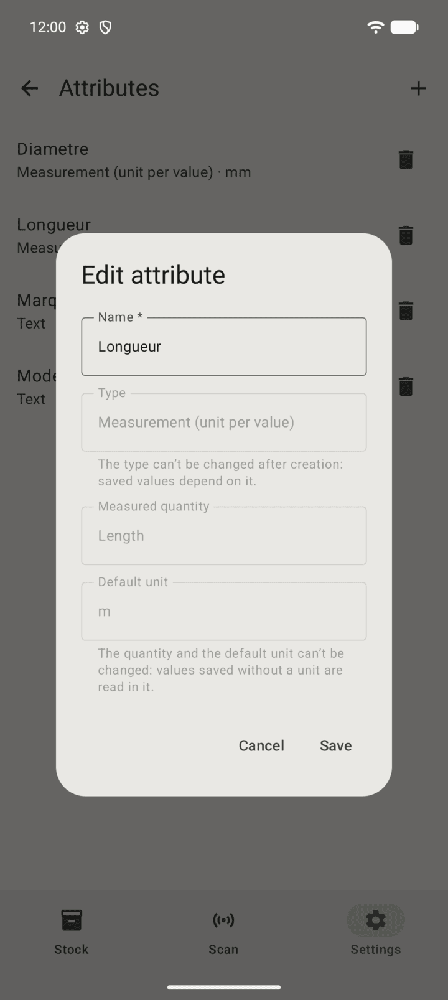<br><sub><i>Measurement attribute with a unit per value</i></sub></td>
  </tr>
  <tr>
    <td align="center" valign="top">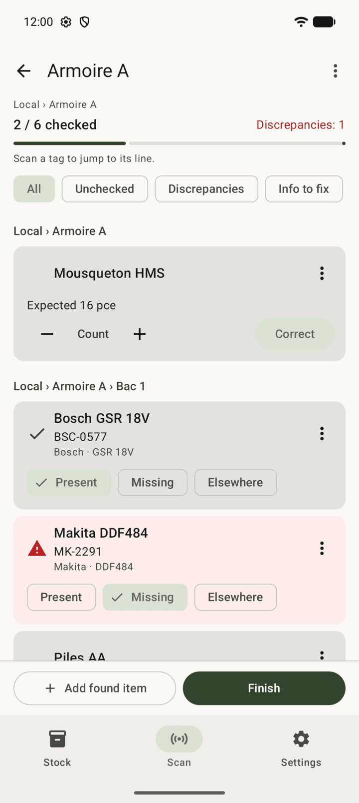<br><sub><i>Stock review: check each article or unit of a location</i></sub></td>
    <td align="center" valign="top">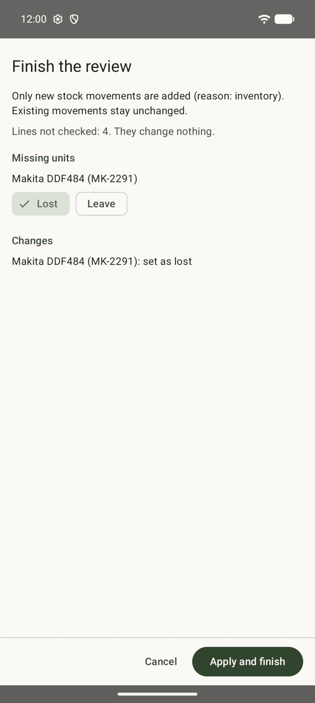<br><sub><i>Review summary before applying the changes</i></sub></td>
    <td align="center" valign="top">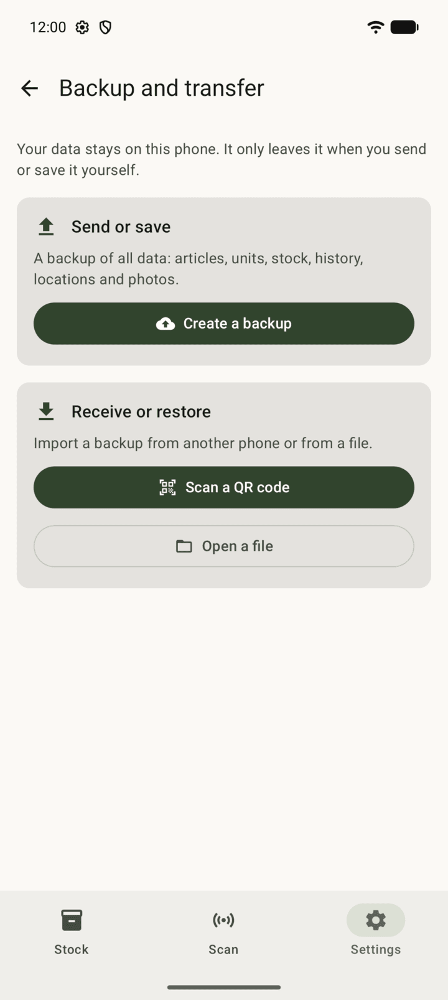<br><sub><i>Backup and transfer: file, QR code or Wi-Fi</i></sub></td>
  </tr>
</table>

---

## About EasyStock

EasyStock is a free, open-source Android app to manage a physical stock with NFC tags. Scan the tag on a shelf or bin to see the article, update the quantity on the spot, and get notified when stock drops below a threshold.

It is built for small businesses (1-5 people), associations and hobbyists who can't justify paid tools. Everything works offline on the phone: no server, no account, no tracking. Data stays on the device, which keeps personal data minimal and local, in line with the Swiss nFADP and the GDPR.

Target hardware budget: 100 CHF. 3D-printable NFC tag holders will be published separately.

---

## 🎓 School project

<p align="center">
  <a href="https://www.cpne.ch">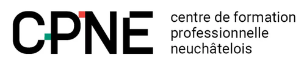</a>
</p>

EasyStock is my TIP (2026-2027) at the [CPNE](https://www.cpne.ch), Centre de formation professionnelle neuchâtelois, Technologies et Industrie pole (CPNE-TI).

---

## ⚠️ Disclaimer

- **EARLY VERSION**: EasyStock is at 0.x. The data format may change between minor versions.
- **BACK UP BEFORE UPDATING**: export a backup file first (Settings > backup).
- **USE PERMANENT-UID NFC TAGS**: NTAG213, NTAG215 or NTAG216. Not bank cards or phone-emulated cards, whose ID changes on every read.
- **iOS IS NOT SUPPORTED**: the iOS target compiles from the same code but is not tested.

---

## 🏷️ Supported NFC tags

- The app reads the tag UID in reader mode (NFC-A/B/F/V). It does not read or write NDEF data, so tags stay untouched.
- One tag belongs to one article OR one location, never both. A scan looks it up by its tag ID. Deleting an article frees its tag for reuse.
- A location can optionally have its own tag: scanning it shows the location contents, sub-locations included.
- NFC needs a real device, the emulator can't scan.

---

## Features

### NFC scan
- Scan an article tag to open the article and its stock.
- Scan a location tag to see what is stored there, sub-locations included.
- An unknown tag can be linked to an existing article or location, or used to create one.

### Stock and search
- Quantities per article, filters, add or remove stock in one tap.
- Search across names and attributes.

### Articles and photos
- Take a picture or pick one from the gallery, then crop it.

### Attributes and measurements
- Custom attributes per category: text, number, or measurement with a unit chosen per value.

### Name templates
- Build the article name from its attributes.

### Tools and consumables
- Track tools one by one (serial units with their own properties and location), or count consumables as a quantity.

### Locations
- Hierarchy (room > shelf > bin), with an icon and a color per location.

### Low stock
- Threshold per article, with a notification. Not applied to serial-tracked articles.

### Stock review
- Go through a location, tick off what is there, and see the gaps in a summary.

### Backup and transfer
- Export to a file, a QR code, or over the local Wi-Fi.
- Optional password. Merge into or replace the existing data.

### Languages
- English, French, German.

---

## Roadmap

- Server mode (multiple users, movement history). Optional: standalone stays the default.

---

## How to build

Requirements: Android Studio (recent stable) with Android SDK 37, JDK 21 (auto-provisioned by Gradle), a device or emulator on API 26+.

```
./gradlew :androidApp:assembleDebug       # debug APK
./gradlew :shared:testAndroidHostTest     # shared logic tests, JVM
```

Or open the root folder in Android Studio and run the `androidApp` configuration. No environment variables are needed.

Kotlin Multiplatform + Compose Multiplatform:

| Path | Content |
|---|---|
| `shared/src/commonMain` | All UI and logic |
| `shared/src/commonMain/composeResources` | Icons and strings (`values`, `values-fr`, `values-de`) |
| `androidApp` | Android entry point |
| `iosApp` | iOS entry point (not supported) |
| `docs/schema.dbml` | Database schema ([dbdiagram.io](https://dbdiagram.io) can draw it) |

Data model: catalogue (`category`, `attribute_definition`, `category_attribute`, `article`), physical stock (`location`, `item`), and `stock_movement`, append-only (stock = `SUM(quantity)`). UUID keys generated on the device, UTC timestamps, soft delete via `deleted_at`.

---

## Contributing

Branch from `main`, open a pull request.

Commits follow [Conventional Commits](https://www.conventionalcommits.org):

```
<type>(<optional scope>): <imperative short description>
```

| Type | Use for |
|---|---|
| `feat` | New feature |
| `fix` | Bug fix |
| `docs` | Documentation only |
| `refactor` | Code change with no behavior change |
| `test` | Adding or fixing tests |
| `chore` | Build, dependencies, config |
| `style` | Formatting only |

Examples: `feat(scan): read NFC tag id`, `fix: keep selected tab on rotation`.

Code, comments and commit messages in English. Files in UTF-8.

---

## Releases

Tags are plain [SemVer](https://semver.org), no `v` prefix. Pushing a tag `X.Y.Z` runs [`.github/workflows/release.yml`](.github/workflows/release.yml): tests, signed release APK, then a GitHub release with the APK, its SHA-256 and notes generated by [git-cliff](https://git-cliff.org) from the commits ([`cliff.toml`](cliff.toml)). A tag with a suffix (`1.0.0-beta.1`) is published as a pre-release.

```
git tag 0.1.0
git push origin 0.1.0
```

`versionName` = tag, `versionCode` = `MAJOR*10000 + MINOR*100 + PATCH`.

Required repository secrets (Settings > Secrets and variables > Actions):

| Secret | Content |
|---|---|
| `ANDROID_KEYSTORE_BASE64` | Release keystore, base64-encoded |
| `ANDROID_KEYSTORE_PASSWORD` | Keystore password |
| `ANDROID_KEY_ALIAS` | Key alias |
| `ANDROID_KEY_PASSWORD` | Key password |

Never commit the keystore. Losing it means users can't update the app anymore, keep a backup outside the repo.

---

## License

[MIT](LICENSE) © 2026 EasyStock contributors. Free to use, change and share, as long as the copyright notice is kept.


